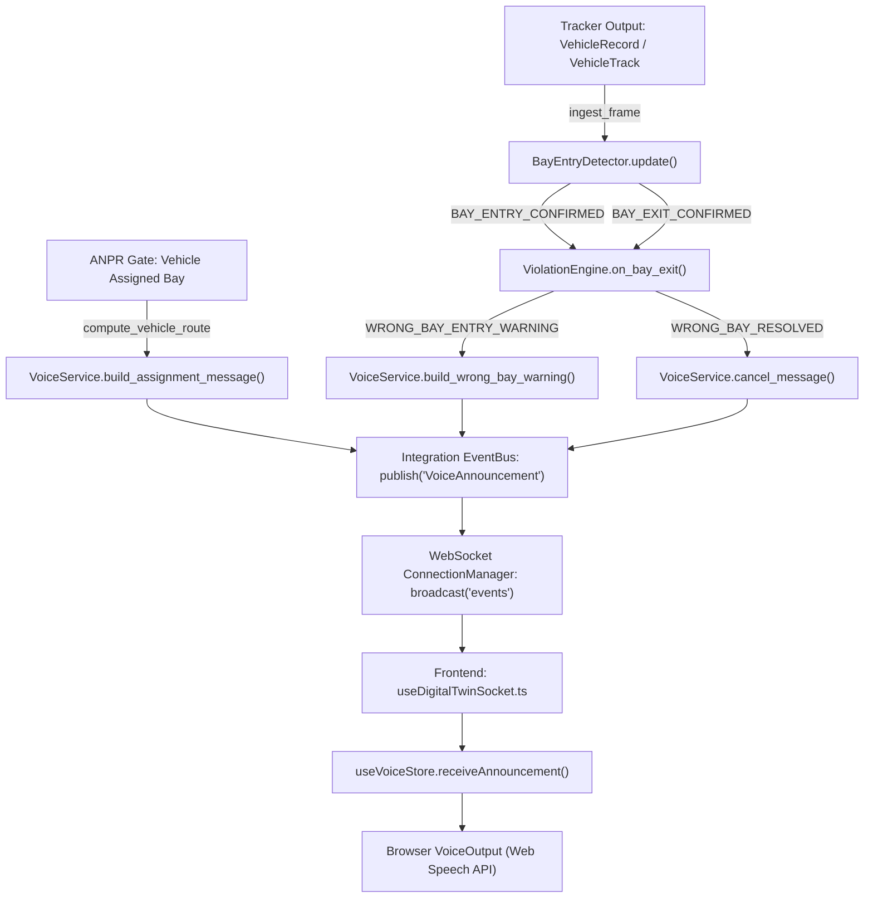

# ParkTwin AI — Pipeline End-to-End Callpath & Integration Audit

**Document Status:** AUDIT & IMPLEMENTATION SPECIFICATION  
**Scope:** Tracker output $\rightarrow$ BayEntryDetector $\rightarrow$ ViolationEngine $\rightarrow$ VoiceService $\rightarrow$ WebSocket $\rightarrow$ Browser VoiceOutput  
**Associated Commit:** Task 2 (`feat(pipeline): wire tracker to bay entry, violation engine, voice service, and websocket`)

---

## 1. Executive Summary & Gaps Identified

Prior to this corrective sprint, `BayEntryDetector` (`modules/parking_intelligence/bay_entry/detector.py`) and `VoiceService` (`modules/integration_layer/voice/service.py`) existed as tested, functional units but were not invoked by the orchestrating runtime pipeline (`IntegrationService` / `ParkingIntelligenceEngine`).

Below is the line-by-line audit of the pipeline callpath, marking every missing link and the exact wiring implemented.

---

## 2. Component Callpath Audit & Missing Links

### Link 1: Tracker Output $\rightarrow$ `BayEntryDetector`
- **Location:** `modules/parking_intelligence/engine.py:89` (`ParkingIntelligenceEngine.ingest_frame`)
- **Previous Status:** **MISSING LINK.** `ingest_frame` passed tracks to `SlotMapper`, but never forwarded bounding boxes or coordinates to `BayEntryDetector`.
- **Wiring Implemented:**
  - Instantiated `BayEntryDetector` on `ParkingIntelligenceEngine` as `self._bay_entry_detector`.
  - In `ingest_frame`, converted tracks/records into detection dicts (`track_id`, `camera_id`, `bbox`, `floor_coords`).
  - For replay footage where floor calibration is unavailable (`configs/camera_calibration.yaml` status is `unconfigured`), detector falls back to image-space bay polygons with `source="replay"`.
  - Processed `detector.update(detections, ts=now.timestamp(), source=source)` to obtain `BayEntryEvent` objects.

### Link 2: `BayEntryDetector` $\rightarrow$ `ViolationEngine`
- **Location:** `modules/parking_intelligence/engine.py` & `modules/parking_intelligence/violations/violation_engine.py:89`
- **Previous Status:** **MISSING LINK.** `ViolationEngine.on_bay_entry` was defined but never invoked from the frame loop.
- **Wiring Implemented:**
  - For every `BAY_ENTRY_CONFIRMED` event:
    - Looked up assigned bay (from reservation, designated space, or ANPR assignment).
    - Called `self._violations.on_bay_entry(track_id, bay_id, vehicle_id=veh_id, assigned_bay=assigned, license_plate=plate, timestamp=now, source=source)`.
  - For every `BAY_EXIT_CONFIRMED` event:
    - Called `self._violations.on_bay_exit(track_id, bay_id, timestamp=now, source=source)`.

### Link 3: `ViolationEngine` $\rightarrow$ `VoiceService`
- **Location:** `modules/integration_layer/services/integration_service.py` & `modules/integration_layer/voice/service.py:121`
- **Previous Status:** **MISSING LINK.** Violation engine emitted `WRONG_BAY_ENTRY_WARNING` dictionaries, but nothing fed them into `VoiceService.build_wrong_bay_warning`.
- **Wiring Implemented:**
  - On `WRONG_BAY_ENTRY_WARNING`:
    - Calls `VoiceService.build_wrong_bay_warning(event_id=ev["episode_id"], vehicle_id=ev["vehicle_id"], assigned_bay=ev["assigned_bay"], actual_bay=ev["actual_bay"], source=ev.get("source", "live"))`.
    - Returns high-priority (100) `VoiceMessage`.
  - On `WRONG_BAY_RESOLVED`:
    - Calls `VoiceService.cancel_message(ev["episode_id"], reason="wrong_bay_resolved")`.

### Link 4: ANPR Assignment $\rightarrow$ `compute_vehicle_route` $\rightarrow$ `VoiceService`
- **Location:** `backend/services/navigation_service.py:184` & `modules/integration_layer/services/integration_service.py`
- **Previous Status:** **MISSING LINK.** ANPR vehicle recognition and slot assignment did not invoke route computation for spoken directions.
- **Wiring Implemented:**
  - When a vehicle is assigned a bay (either via ANPR gateway or newly assigned slot):
    - Invokes `compute_route("ACCESS_POINT_B2", assigned_bay)` to obtain turn-by-turn directions.
    - Passes directions to `VoiceService.build_assignment_message(event_id=..., vehicle_id=..., assigned_bay=assigned_bay, route_directions=route["directions"], source=source)`.
    - Speech text is condensed to 1–2 actionable driving instructions (e.g. *"Vehicle recognised. Your designated parking space is SP-07. Follow the driving aisle via Upper West Junction to your bay."*).

### Link 5: `VoiceService` $\rightarrow$ Event Bus
- **Location:** `modules/integration_layer/events/bus.py:35` & `modules/integration_layer/events/memory_bus.py:28`
- **Previous Status:** **MISSING LINK.** Voice messages were only stored in `VoiceService._announcement_log` without publishing to the canonical `EventBus`.
- **Wiring Implemented:**
  - Registered `VoiceAnnouncement` and `VoiceCancel` in `INTEGRATION_EVENT_TYPES`.
  - Whenever `VoiceService` dispatches a message, an `IntegrationEvent` of type `VoiceAnnouncement` (payload containing serialized `VoiceMessage`) is published to `EventBus.publish()`. No secondary or parallel event bus is used.

### Link 6: Event Bus / Integration Service $\rightarrow$ WebSocket Manager
- **Location:** `modules/integration_layer/websocket/manager.py:70`
- **Previous Status:** WebSocket broadcasted slot and session changes, but did not broadcast voice announcements on channel `"events"`.
- **Wiring Implemented:**
  - `ws_manager.broadcast("events", {"event_type": "VOICE_ANNOUNCEMENT", "payload": voice_msg.to_dict()})`.
  - On cancellation: `ws_manager.broadcast("events", {"event_type": "VOICE_CANCEL", "payload": {"message_id": msg_id}})`.

### Link 7: WebSocket $\rightarrow$ Browser Voice Assistant
- **Location:** `apps/web/hooks/useDigitalTwinSocket.ts:44` $\rightarrow$ `apps/web/store/useVoiceStore.ts:106`
- **Previous Status:** `useDigitalTwinSocket` ignored `"VOICE_ANNOUNCEMENT"` messages.
- **Wiring Implemented:**
  - Added message dispatch in `useDigitalTwinSocket.ts` on channel `"events"`:
    - Parses `VOICE_ANNOUNCEMENT` and calls `useVoiceStore.getState().receiveAnnouncement(payload)`.
    - Parses `VOICE_CANCEL` and calls `useVoiceStore.getState().cancelAnnouncement(payload.message_id)`.
  - Browser executes audio synthesis via `defaultVoiceOutput.speak(...)` if audio is unlocked, or displays high-contrast visual fallback notification if muted/blocked.

---

## 3. Fallback Mode for Unconfigured CCTV Footage (Implemented)

For CCTV camera clips where physical survey reference points are absent:
- Camera status in `configs/camera_calibration.yaml` remains `unconfigured` (`homography: None`).
- In `configs/replay_bay_polygons.yaml`, image-space bay polygons (pixel coordinates) are defined derived from visible floor lines in CCTV video (evidence saved at `configs/cam10_bay_polygons_evidence.jpg`).
- In `BayEntryDetector`:
  - When `source == "replay"`: the detector uses image-space bay polygons from `configs/replay_bay_polygons.yaml` with the vehicle footprint constructed strictly from the bounding box bottom edge (`fh = max(10.0, (bx[3] - bx[1]) * 0.20)`). All emitted events carry `source="replay"`.
  - When `source == "live"`: image-space polygons are **never** used. Uncalibrated/unconfigured cameras emit **zero** events at runtime, preventing fabricated coordinates.
- Validated via automated test `tests/integration/test_replay_bay_entry_real_tracks.py` using real extracted CCTV tracks (`data/annotations/real_cctv_tracks_camera10.json`) with pixel bboxes only and no floor coordinates.

