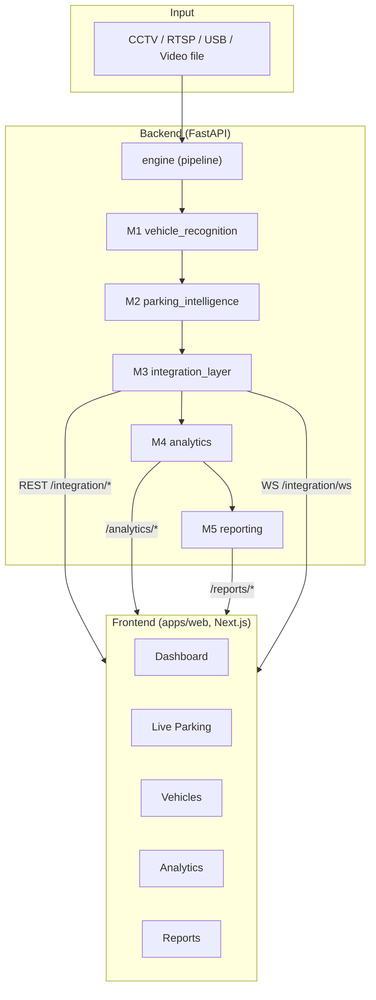
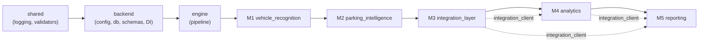
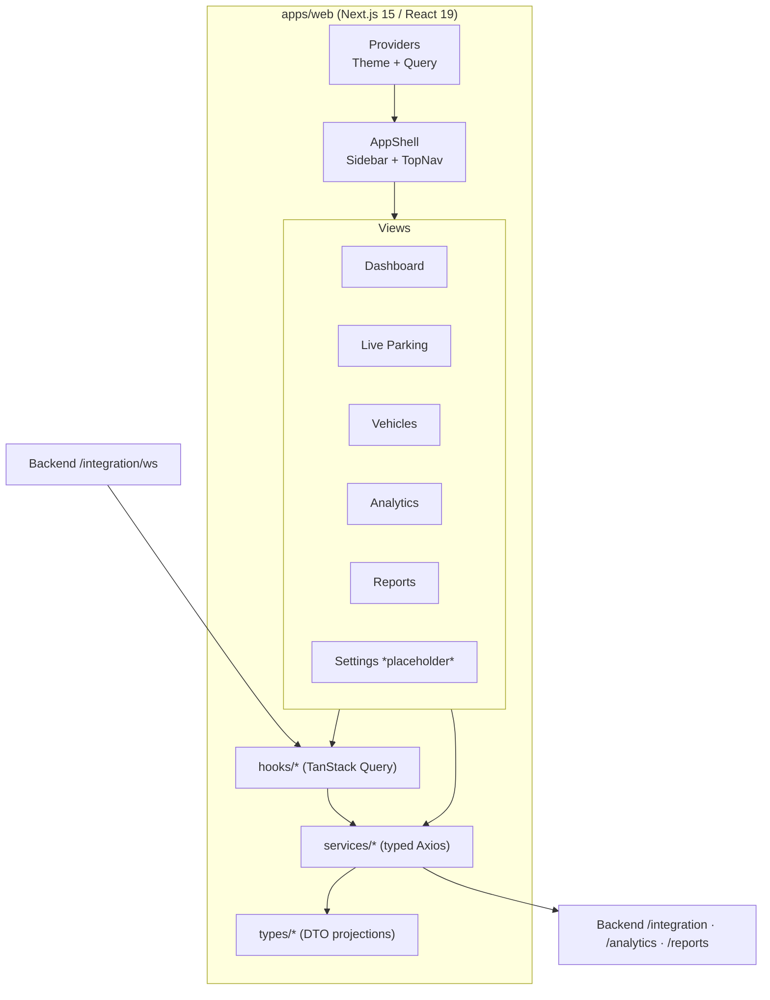
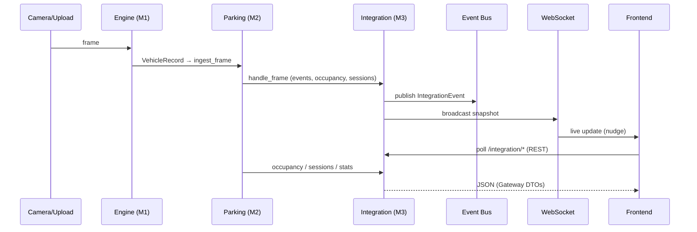
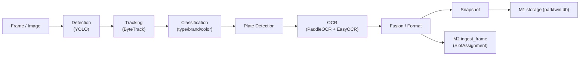
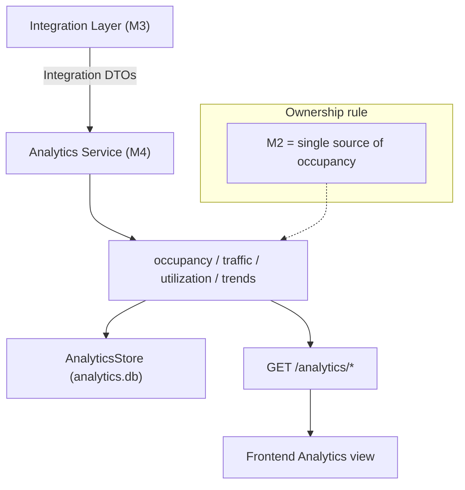
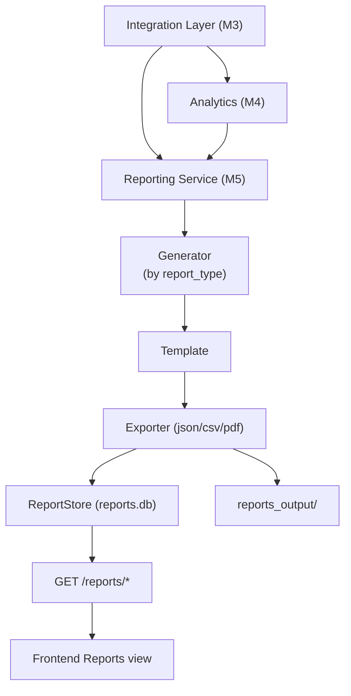

# Diagrams

Mermaid diagrams for ParkTwin AI. They render on GitHub and in most Markdown
viewers. The authoritative text descriptions live in
[`PROJECT_MEMORY.md`](../../PROJECT_MEMORY.md) and
[`docs/architecture/architecture.md`](../../docs/architecture/architecture.md).

1. [Overall Architecture](#1-overall-architecture)
2. [Backend Modules](#2-backend-modules)
3. [Frontend Modules](#3-frontend-modules)
4. [Data Flow](#4-data-flow)
5. [Vehicle Processing Pipeline](#5-vehicle-processing-pipeline)
6. [Analytics Flow](#6-analytics-flow)
7. [Reporting Flow](#7-reporting-flow)

---

## 1. Overall Architecture

---

## 2. Backend Modules

---

## 3. Frontend Modules

---

## 4. Data Flow

---

## 5. Vehicle Processing Pipeline

---

## 6. Analytics Flow

---

## 7. Reporting Flow

