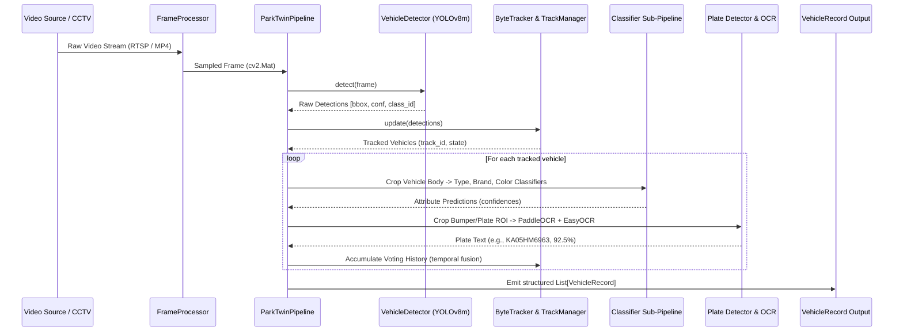

# Section 01: AI Pipeline & Engine Architecture

The **AI Pipeline** layer (`engine/`) is the central orchestrator of ParkTwin AI. It ingests video frames from camera capture threads or HTTP upload handlers, executes computer vision models in sequence, and outputs structured, track-confirmed `VehicleRecord` objects.

---

## Architecture & Data Flow

---

## Key Data Structures

### `VehicleRecord` Data Class (`engine/pipeline.py`)

The primary output generated for every detected vehicle per frame:

| Field | Type | Description |
| :--- | :--- | :--- |
| `record_id` | `str` (UUIDv4) | Unique identifier for this detection event |
| `tracking_id` | `Optional[int]` | Persistent tracking ID assigned by ByteTrack across video frames |
| `camera_id` | `str` | Camera identifier (e.g., `camera_01`, `CAM_UPLOAD`, `station_entry`) |
| `frame_id` | `int` | Sequential frame index from the video stream |
| `bbox` | `List[float]` | Normalized bounding box coordinates `[x1, y1, x2, y2]` in range [0.0, 1.0] |
| `detection_confidence` | `float` | YOLO detection confidence score (0.0 to 1.0) |
| `vehicle_class_raw` | `str` | Raw YOLO class name (`car`, `truck`, `bus`, `motorcycle`) |
| `vehicle_type` | `str` | Refined vehicle type (`Sedan`, `SUV`, `Hatchback`, `Van`, `Coupe`, `Motorcycle`) |
| `type_confidence` | `float` | Vehicle type classification confidence score |
| `brand` | `str` | Vehicle manufacturer (`Toyota`, `Hyundai`, `Kia`, `Maruti Suzuki`, `Volkswagen`, etc.) |
| `brand_confidence` | `float` | Brand classification confidence score |
| `color` | `str` | Predominant vehicle body color (`Black`, `White`, `Silver`, `Red`, `Blue`, `Grey`, etc.) |
| `color_confidence` | `float` | Color recognition confidence score |
| `license_plate` | `str` | Formatted Indian license plate or standard text (`KA05HM6963`) |
| `plate_raw` | `str` | Unprocessed OCR text before heuristic formatting |
| `plate_confidence` | `float` | Aggregated OCR recognition confidence score |
| `plate_format` | `str` | Plate classification (`indian_standard`, `standard`, `unknown`) |
| `plate_bbox` | `List[float]` | Normalized bounding box of the license plate relative to vehicle crop |
| `timestamp` | `datetime` | UTC timestamp of the observation |
| `snapshot_path` | `Optional[str]` | File path of the saved cropped snapshot of the vehicle |
| `plate_snapshot_path`| `Optional[str]` | File path of the saved cropped snapshot of the license plate |

---

## Configuration Parameters (`configs/settings.yaml`)

| Setting | Default | Tuned CPU Value | Description |
| :--- | :--- | :--- | :--- |
| `detection.confidence_threshold` | `0.50` | `0.50` | Minimum YOLO confidence to consider a vehicle detection |
| `detection.iou_threshold` | `0.45` | `0.45` | NMS IoU threshold for overlapping vehicle candidate boxes |
| `tracking.track_buffer` | `60` | `300` | Frames to keep lost tracks alive (extended to prevent track splitting during frame skips) |
| `ocr.confidence_threshold` | `0.45` | `0.45` | Minimum OCR character confidence to accept a plate reading |
| `ocr.engine` | `paddleocr` | `paddleocr` | Primary OCR engine (`paddleocr` with `easyocr` fallback) |

---

## Detailed Documentation in This Section

- [`pipeline.md`](./pipeline.md) — Comprehensive breakdown of `ParkTwinPipeline` lifecycle, primary/secondary detection passes, temporal voting, and CPU vs GPU profiling.
- [`frame_processor.md`](./frame_processor.md) — Multi-threaded OpenCV capture loops, frame buffer queues, frame skip algorithms, and error recovery.
