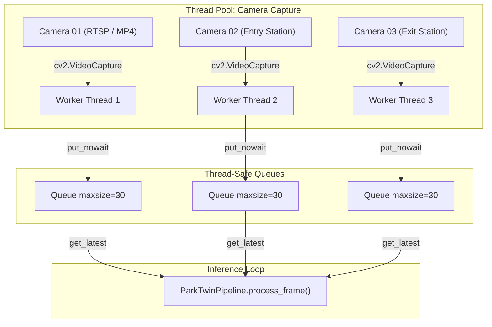

# Frame Processor & Stream Manager (`engine/frame_processor.py`)

The `FrameProcessor` manages video stream ingestion from RTSP IP cameras, USB webcams, and MP4 video test files.

---

## Threading Architecture

Each camera operates on a dedicated daemon thread to prevent network latency or video decoding stalls on one camera from blocking inference on other channels.

---

## Key Capabilities

### 1. Auto-Reconnect Backoff
If an RTSP stream disconnects due to network flapping, `FrameProcessor` executes an exponential backoff reconnect loop (initial delay 1.0s, doubling up to 30.0s max).

### 2. Adaptive Frame Dropping (Queue Saturation Protection)
When the AI inference loop takes longer than frame inter-arrival time (common in CPU-only setups):
- Frame queue is bounded to `maxsize=30`.
- When full, `put_nowait()` discards oldest intermediate frames, keeping only the freshest frame to prevent latency buildup.

### 3. Graceful Teardown
Thread cancellation tokens and `stop()` events release underlying OpenCV `VideoCapture` handles and POSIX file descriptors cleanly.
