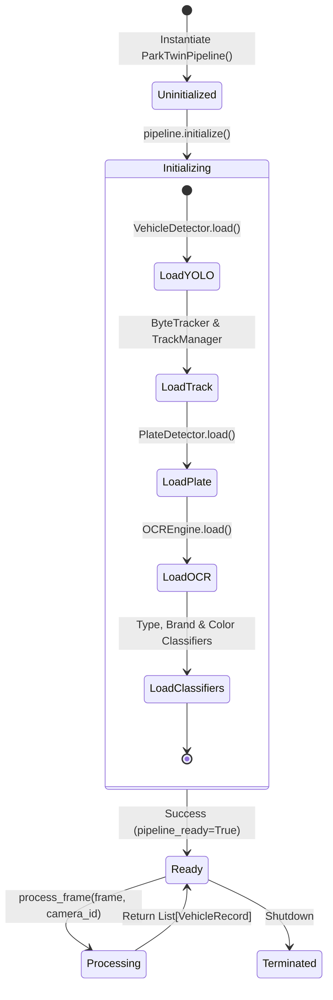
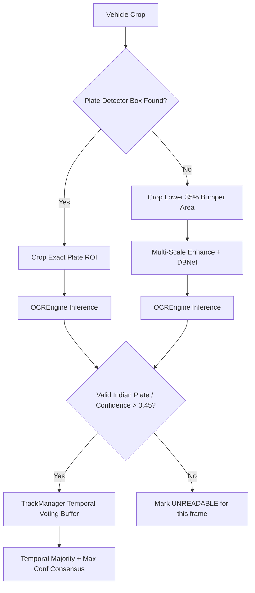

# AI Pipeline Engine (`engine/pipeline.py`)

The `ParkTwinPipeline` class is the master coordinator for all deep learning models, spatial tracking, and attribute recognition routines in ParkTwin AI.

---

## Class Architecture & Lifecycle



---

## Method Breakdown

### 1. `initialize()`
Initializes and warms up all sub-components in deterministic order:

```python
def initialize(self) -> None:
    """Loads weights into memory and prepares CUDA/CPU execution providers."""
    start_t = time.perf_counter()
    logger.info("🚀 Initializing ParkTwin AI Pipeline...")

    self.vehicle_detector.load()      # YOLOv8m (PyTorch weights: models/yolov8m.pt)
    self.track_manager.reset()        # Clear any stale tracks
    self.plate_detector.load()        # PaddleOCR DBNet text region fallback
    self.ocr_engine.load()            # PaddleOCR (mkldnn=False) + EasyOCR
    self.type_classifier.load()       # MobileNetV3-Small deep learning backbone
    self.brand_classifier.load()      # EfficientNet-B0 feature backbone
    self.color_recognizer.load()      # HSV median color space matcher

    self.is_ready = True
    elapsed = (time.perf_counter() - start_t) * 1000
    logger.info(f"✅ Pipeline ready in {elapsed:.0f}ms")
```

### 2. `process_frame(frame, camera_id, frame_id, timestamp)`
Executes the inference loop over a single image or video frame:

1. **Detection Pass**: Calls `VehicleDetector.detect(frame)` returning `List[DetectionResult]`.
2. **Multi-Object Association**: Updates `ByteTracker` and `TrackManager` with candidate bounding boxes.
3. **Vehicle ROI Extraction**: Crops each confirmed vehicle image from the full frame.
4. **Attribute Recognition**: Runs type, brand, and color classifiers concurrently on the vehicle crop.
5. **Primary Plate Pass**: Calls `PlateDetector.detect(vehicle_crop)` to locate rectangular plate regions.
6. **Secondary Bumper ROI Pass**: If primary detection fails, crops the lower 35% bumper region and executes multi-scale OCR with format validation.
7. **Temporal Voting**: Feeds recognized plates, brands, and colors to `TrackManager` to establish temporal consensus across multiple video frames.
8. **Record Serialization**: Formats all results into `VehicleRecord` objects.

```python
# Primary vs Secondary Plate Detection Pass Excerpt from engine/pipeline.py
plate_detections = self.plate_detector.detect(vehicle_crop)

if plate_detections:
    # Primary Pass: Dedicated plate bounding box found
    best_plate_det = max(plate_detections, key=lambda p: p.confidence)
    plate_crop = self.plate_detector.crop_plate(vehicle_crop, best_plate_det.bbox)
    ocr_result = self.ocr_engine.read(plate_crop)
else:
    # Secondary Pass: Lower 35% vehicle bumper fallback
    h, w = vehicle_crop.shape[:2]
    bumper_roi = vehicle_crop[int(h * 0.65):h, int(w * 0.15):int(w * 0.85)]
    ocr_result_roi = self.ocr_engine.read(bumper_roi)
    if ocr_result_roi.raw_text and ocr_result_roi.confidence >= min_ocr_conf:
        ocr_result = ocr_result_roi
```

---

## Two-Pass Detection & Temporal Voting



### Temporal Voting Rules
- **Plate Number**: Weighted average by confidence score. Matches complying with Indian Standard format (`KA05HM6963`) receive a **1.10x weight multiplier**.
- **Vehicle Brand**: Mode of top 10 historical classifications.
- **Vehicle Type**: Softmax logit accumulation across all active frames for the track ID.
- **Color**: Rolling median in HSV color space to eliminate transient lighting glares.

---

## CPU vs GPU Performance Profiles

| Component | GPU (NVIDIA RTX 4090 / T4) | CPU (Intel Core i7 / AMD Ryzen) | Optimization Applied |
| :--- | :---: | :---: | :--- |
| **YOLOv8m Detection** | 8 – 12 ms | 140 – 180 ms | FP16 Half Precision on CUDA |
| **ByteTrack Association** | < 1 ms | 2 – 5 ms | Vectorized NumPy IoU |
| **MobileNetV3 Classification**| 3 – 5 ms | 20 – 35 ms | TorchScript JIT Optimization |
| **EfficientNet-B0 Brand** | 4 – 6 ms | 30 – 45 ms | TorchScript JIT Optimization |
| **Color Recognizer** | < 1 ms | 2 – 4 ms | NumPy HSV Vectorized Histogram |
| **PaddleOCR Plate Text** | 12 – 20 ms | 600 – 950 ms | `enable_mkldnn=False`, 32-stride align |
| **Total per Frame (Full Load)**| **~45 ms (22 FPS)** | **~2,500 – 5,000 ms (0.2–0.4 FPS)**| Adaptive Frame Skip (1-in-15 / 1-in-30) |
