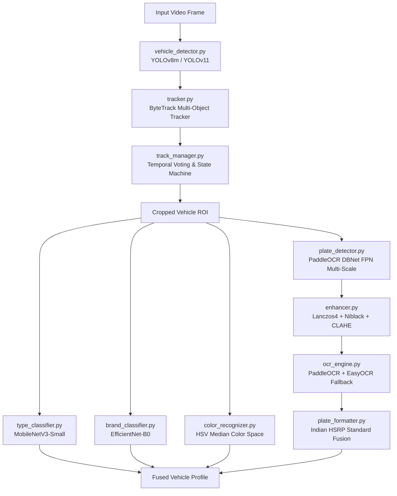

# Section 02: Vehicle Recognition Subsystem

The **Vehicle Recognition Subsystem** (`modules/vehicle_recognition/`) houses the specialized computer vision models and heuristic post-processors responsible for detecting vehicles, reading license plates, and extracting vehicle metadata.

---

## Subsystem Topology

---

## Sub-Module Directory Reference

| Document | Sub-Module | Model / Technology | Description |
| :--- | :--- | :--- | :--- |
| [`vehicle_detection.md`](./vehicle_detection.md) | `detection/` | YOLOv8m (Ultralytics) | Object detection for cars, trucks, buses, motorcycles with auto-weight caching |
| [`tracking.md`](./tracking.md) | `tracking/` | ByteTrack + Kalman | Persistent ID assignment, occlusion handling, and temporal consensus voting |
| [`plate_detection.md`](./plate_detection.md) | `plate_detection/`| DBNet FPN (PaddleOCR) | Multi-scale text-region candidate localization with 32-pixel stride alignment |
| [`ocr_engine.md`](./ocr_engine.md) | `ocr/` | PaddleOCR + EasyOCR | License plate text extraction with Lanczos-4 upscaling & Niblack binarization |
| [`classification.md`](./classification.md) | `classification/` | MobileNetV3 + EfficientNet | Deep vehicle type, brand, and HSV median color recognition |
| [`plate_formatter.md`](./plate_formatter.md) | `fusion/` | Regex + HSRP Strip | Indian Standard plate format validation and confidence scoring |
