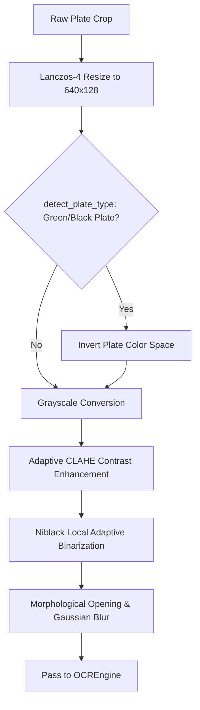

# OCR Engine & Image Enhancement (`modules/vehicle_recognition/ocr/`)

The OCR subsystem extracts alphanumeric license plate text using a dual-engine architecture (**PaddleOCR** primary with **EasyOCR** fallback) and specialized image pre-processing.

---

## Image Pre-Processing Pipeline (`enhancer.py`)

---

## Multi-Crop OCR Perturbation

To guarantee high OCR accuracy on vibrating cameras or angled plates, `OCREngine` generates 4 variants per plate:
1. **Tight Bounding Box**: Exact detected text boundary.
2. **5% Padding Expansion**: Adds context around edge characters (`K`, `A`, `0`, `9`).
3. **10% Padding Expansion**: Captures full border of Indian HSRP plates.
4. **$\pm 5^\circ$ Rotation Correction**: Rectifies angled camera views.

The engine scores all predictions and selects the highest confidence text string matching the Indian Standard grammar.
