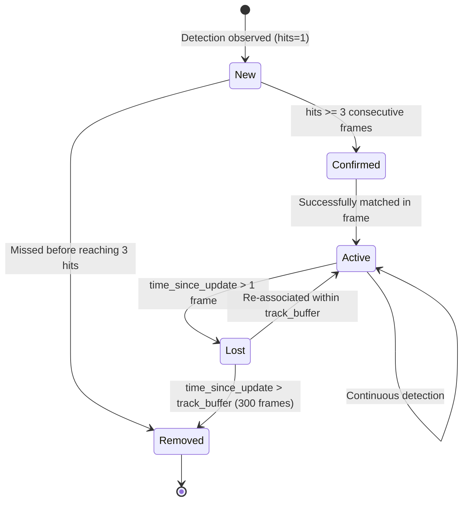

# Vehicle Tracking & State Machine (`modules/vehicle_recognition/tracking/`)

ParkTwin AI uses a pure-Python vectorized implementation of **ByteTrack** (`tracker.py`) coupled with a temporal state machine (`track_manager.py`) to maintain stable identities across occlusions and camera frame skips.

---

## ByteTrack Association Algorithm

ByteTrack solves tracking failure during occlusions by splitting detections into two confidence tiers:

```mermaid
graph TD
    Dets[Frame Detections] --> Split{Confidence >= track_high_thresh (0.50)?}
    Split -->|High Conf| D_High[High Score Detections]
    Split -->|Low Conf| D_Low[Low Score Detections]
    
    Tracks[Active Tracks] --> Stage1[Stage 1: Match D_High with Active Tracks via IoU]
    D_High --> Stage1
    
    Stage1 -->|Matched| Update1[Update Kalman State & History]
    Stage1 -->|Unmatched Tracks| Stage2[Stage 2: Match Unmatched Tracks with D_Low]
    D_Low --> Stage2
    
    Stage2 -->|Matched| Update2[Recover Track through Occlusion]
    Stage2 -->|Still Unmatched| Lost[Mark Track as 'lost' for track_buffer Frames]
    
    Stage1 -->|Unmatched D_High| NewTrack{Conf >= new_track_thresh (0.60)?}
    NewTrack -->|Yes| Spawn[Spawn New Confirmed Track]
```

---

## Track Lifecycle State Machine



---

## Track Buffer Math for Frame Skipping

When running on CPU with frame skipping (e.g., `frame_skip = 15` on a 60 FPS video):
- Each sampled frame corresponds to **0.25 seconds** of real time.
- Standard ByteTrack `track_buffer = 60` would drop tracks after only $60 \times 0.25 = 15$ seconds of occlusion or camera panning.
- ParkTwin AI sets `track_buffer: 300`, keeping vehicle tracks alive for **75 seconds of real-world occlusion**, eliminating duplicate track ID creation.
