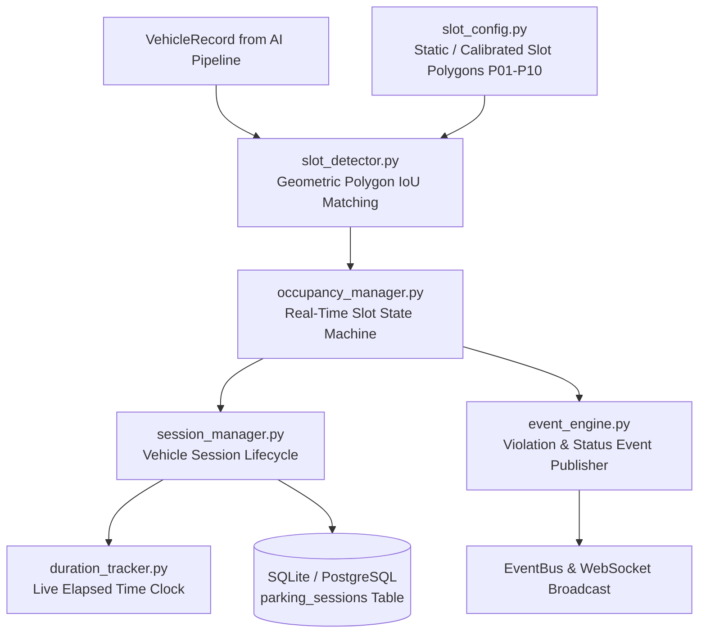

# Section 03: Parking Intelligence Module

The **Parking Intelligence Module** (`modules/parking_intelligence/`) manages physical parking bays, slot geometry, real-time vehicle-to-slot spatial assignment, session life cycles, and parking violation detection.

---

## Subsystem Architecture



---

## Parking Slot Geometry (Default 10-Slot Layout)

The standard parking lot map provides 10 calibrated geometric bounding polygons:

```
[ P01 ] [ P02 ] [ P03 ] [ P04 ] [ P05 ]   <-- North Bay (Lane A)
================= Driving Aisle =================
[ P06 ] [ P07 ] [ P08 ] [ P09 ] [ P10 ]   <-- South Bay (Lane B)
```

---

## Sub-Module Directory Reference

| Document | Sub-Module | Focus & Capabilities |
| :--- | :--- | :--- |
| [`slot_detection.md`](./slot_detection.md) | `slot_detection/` | Polygon coordinates, bottom-center projection, IoU calculation, and spatial thresholding |
| [`occupancy.md`](./occupancy.md) | `occupancy/` | Slot state transition rules (`free` $\leftrightarrow$ `occupied` $\leftrightarrow$ `reserved`), per-camera aggregation |
| [`sessions.md`](./sessions.md) | `sessions/` | Entry-to-exit state machine, plate-to-slot binding, session duration metrics, SQL schema |
| [`events.md`](./events.md) | `events/` | Domain event dispatching (`slot_occupied`, `slot_freed`), overstay & unauthorized parking violations |
