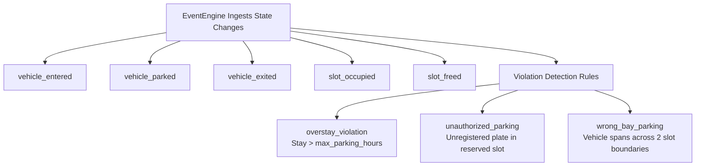

# Parking Events & Violations (`modules/parking_intelligence/events/`)

The `EventEngine` monitors the parking domain for critical business events and automated violation triggers.

---

## Domain Event Types

---

## Violation Detection Parameters

Configured via `configs/settings.yaml`:
- `violations.max_stay_hours`: `24` (triggers alert when exceeded).
- `violations.cross_bay_iou_threshold`: `0.25` on two adjacent slots simultaneously.
