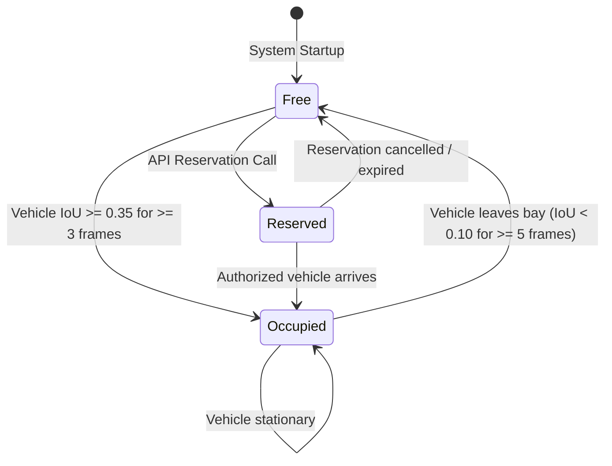

# Real-Time Occupancy Management (`modules/parking_intelligence/occupancy/`)

The `OccupancyManager` maintains an in-memory real-time registry of all slot states across all registered cameras.

---

## State Transition Rules



---

## Aggregate Occupancy REST Response (`/integration/occupancy`)

```json
{
  "total_slots": 10,
  "free": 9,
  "occupied": 1,
  "reserved": 0,
  "unknown": 0,
  "occupancy_rate": 0.10,
  "per_camera": {
    "camera_01": {
      "total": 10,
      "free": 9,
      "occupied": 1,
      "reserved": 0,
      "unknown": 0
    }
  }
}
```
