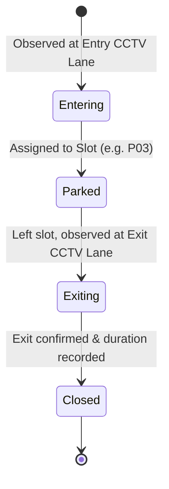

# Parking Session Lifecycle (`modules/parking_intelligence/sessions/`)

The `SessionManager` tracks the lifecycle of every vehicle visit from the moment it enters the lot until it clears the exit station.

---

## Session State Machine

---

## Database Table Schema (`parking_sessions`)

| Column | Type | Constraints | Description |
| :--- | :--- | :--- | :--- |
| `session_id` | `VARCHAR(36)` | `PRIMARY KEY` | UUIDv4 session identifier |
| `license_plate` | `VARCHAR(20)` | `INDEXED` | Formatted plate (e.g. `KA05HM6963`) |
| `slot_id` | `VARCHAR(10)` | `INDEXED` | Calibrated slot ID (e.g. `P01`–`P10`) |
| `tracking_id` | `INTEGER` | `NULLABLE` | Active tracker ID |
| `entry_time` | `TIMESTAMP` | `NOT NULL` | UTC arrival timestamp |
| `parked_time` | `TIMESTAMP` | `NULLABLE` | Timestamp when slot occupancy confirmed |
| `exit_time` | `TIMESTAMP` | `NULLABLE` | UTC departure timestamp |
| `duration_seconds` | `FLOAT` | `DEFAULT 0.0`| Total elapsed stay duration |
| `status` | `VARCHAR(20)` | `INDEXED` | `entering` \| `parked` \| `exited` \| `closed` |
