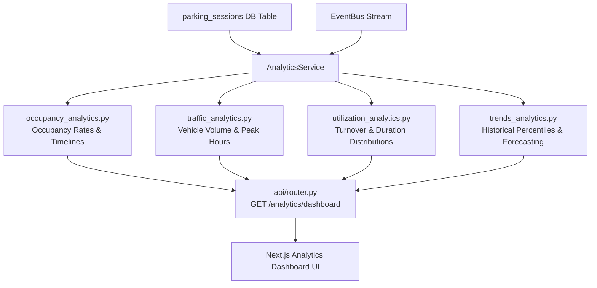

# Section 04: Smart Parking Analytics Engine

The **Analytics Module** (`modules/analytics/`) aggregates parking sessions, vehicle observations, and occupancy timelines into actionable operational metrics, historical trends, and executive dashboards.

---

## Subsystem Architecture

---

## Analytics Sub-Modules Reference

| Document | Component | Metrics Generated |
| :--- | :--- | :--- |
| [`occupancy_analytics.md`](./occupancy_analytics.md) | `OccupancyAnalytics` | Real-time rate, average occupancy %, per-camera distribution, timeline graphs |
| [`traffic_analytics.md`](./traffic_analytics.md) | `TrafficAnalytics` | 24-hour hourly traffic histogram, entry/exit counts, peak hour identification |
| [`utilization_analytics.md`](./utilization_analytics.md) | `UtilizationAnalytics`| Slot turnover rate, utilization %, average parking duration (`HH:MM:SS`), top/bottom slots |
| [`trends_analytics.md`](./trends_analytics.md) | `TrendsAnalytics` | Statistical duration percentiles ($p_{25}, p_{50}, p_{75}, p_{90}$), multi-day trendlines |
| [`api.md`](./api.md) | `AnalyticsRouter` | Full API schema for `/analytics/dashboard`, query filters, and sample curl requests |
