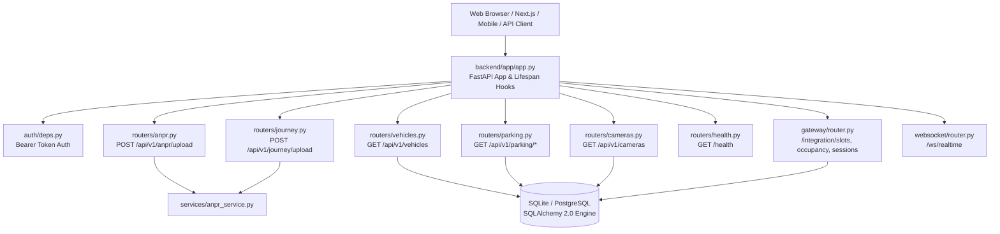

# Section 05: Backend API Architecture

The **Backend API** layer (`backend/`) is built on **FastAPI** and **SQLAlchemy 2.0**, exposing asynchronous REST and WebSocket interfaces for video ingestion, vehicle management, parking control, multi-station journeys, and configuration.

---

## Architecture & Router Topology

---

## Router Directory Reference

| Document | Endpoint Prefix | Purpose |
| :--- | :--- | :--- |
| [`anpr_api.md`](./anpr_api.md) | `/api/v1/anpr` | Multipart video upload, batch ANPR pipeline, annotated video, CSV/JSON downloads, auto-cleanup |
| [`vehicles_api.md`](./vehicles_api.md) | `/api/v1/vehicles` | Search, filter, and retrieve historical vehicle recognition records and snapshot crops |
| [`parking_api.md`](./parking_api.md) | `/api/v1/parking` | Parking slot status queries, reservation overrides, bay configuration |
| [`journey_api.md`](./journey_api.md) | `/api/v1/journey` | Multi-camera journey tracking across Entry Station, Parking Lot, and Exit Station |
| [`auth_and_security.md`](./auth_and_security.md) | N/A | Bearer token authentication, API keys, role-based authorization |
| [`database.md`](./database.md) | N/A | SQLAlchemy ORM models, SQLite WAL mode, schema tables, indexes, and connection pooling |
| [`configuration.md`](./configuration.md) | N/A | Full annotated reference of `settings.yaml` and environment variables |
