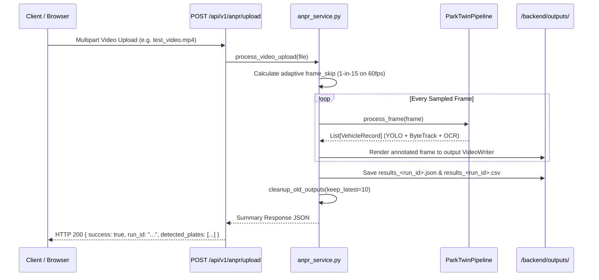

# ANPR Video Upload API (`backend/api/routers/anpr.py`)

The `/api/v1/anpr/upload` endpoint processes raw video files through the full AI recognition pipeline asynchronously.

---

## `POST /api/v1/anpr/upload`

### Request Specifications
- **Content-Type**: `multipart/form-data`
- **Headers**: `Authorization: Bearer dev_admin_token`
- **Body Form**:
  - `video`: File binary (`.mp4`, `.avi`, `.mov`, `.mkv`).

---

### Pipeline Execution Flow

---

### Storage Management & Pruning (`cleanup_old_outputs`)

To prevent disk bloat on continuous usage, `anpr_service.py` executes automated pruning after every upload:
- Retains the **10 most recent runs**.
- Prunes all benchmark and temporary upload files older than **3 days**.
- Reclaims gigabytes of disk space automatically.
