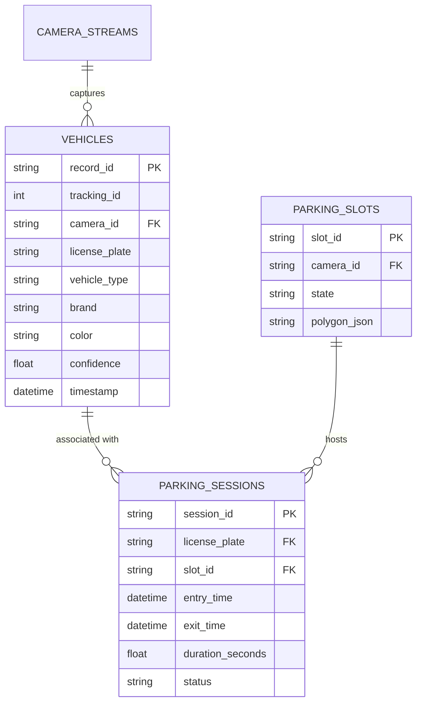

# Database & SQLAlchemy Schema (`backend/database/`)

ParkTwin AI uses **SQLAlchemy 2.0** ORM supporting SQLite with Write-Ahead Logging (WAL) in development and PostgreSQL in production.

---

## Database Tables Entity Relationship Diagram

---

## SQLite Performance Tuning
For high-concurrency event ingestion:
- `journal_mode = WAL` (Write-Ahead Logging allows concurrent reads while writing).
- `synchronous = NORMAL`.
- `busy_timeout = 5000` ms.
