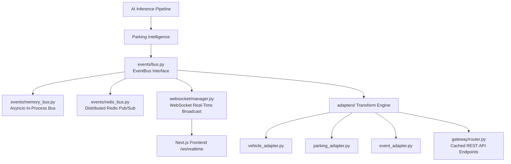

# Section 06: Integration Layer & Real-Time Event Bus

The **Integration Layer** (`modules/integration_layer/`) decouples low-level computer vision processing from high-level API routers, WebSockets, and external microservices.

---

## Topology

---

## Directory Reference

| Document | Component | Description |
| :--- | :--- | :--- |
| [`event_bus.md`](./event_bus.md) | `events/` | Pub/Sub messaging bus with Memory and Redis backends |
| [`websocket.md`](./websocket.md) | `websocket/` | Real-time WebSocket connection manager and multiplexed broadcasting |
| [`adapters.md`](./adapters.md) | `adapters/` | Domain entity to API DTO transformation layer |
| [`gateway.md`](./gateway.md) | `gateway/` | Unified caching REST integration gateway endpoints |
