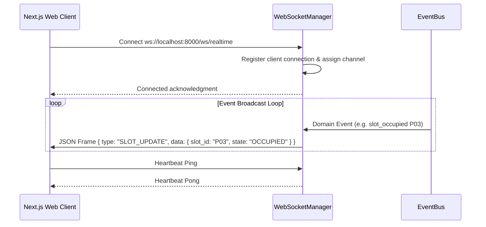

# WebSocket Real-Time Manager (`modules/integration_layer/websocket/`)

Maintains persistent duplex connections with frontend browser clients at `/ws/realtime`.

---

## Connection Lifecycle & Message Broadcasting

