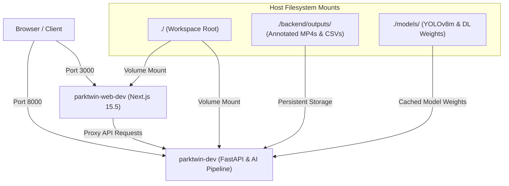

# Section 08: DevOps & Container Architecture

ParkTwin AI uses multi-container **Docker Compose** topologies for hot-reloading development and scalable production deployments.

---

## Container Architecture

---

## DevOps Reference Documents

| Document | Topic | Description |
| :--- | :--- | :--- |
| [`docker.md`](./docker.md) | Docker Specs | `docker-compose.hotdev.yml` breakdown, commands, and GPU setup |
| [`configuration.md`](./configuration.md) | Environment Config | Complete guide to `.env`, `.env.production`, and tuning knobs |
| [`deployment.md`](./deployment.md) | Production Guide | PostgreSQL migration, Redis EventBus, SSL/TLS with Caddy/Nginx |
