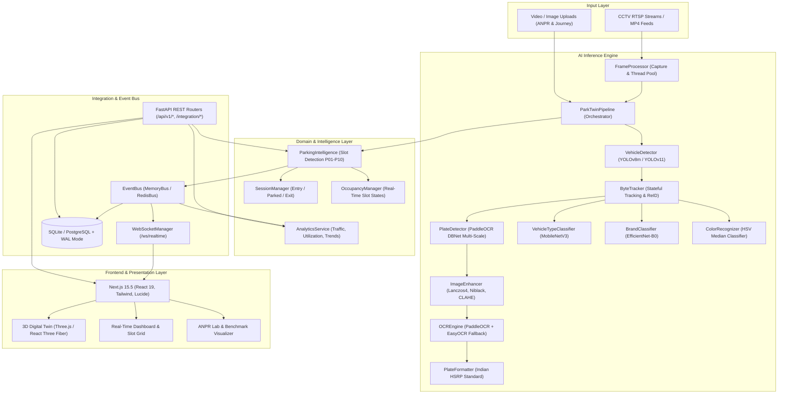

# ParkTwin AI — System Architecture & Module Reference Manual

Welcome to the comprehensive architecture and module documentation for **ParkTwin AI**, an enterprise-grade digital twin, vehicle intelligence, automated number plate recognition (ANPR), and smart parking analytics platform.

---

## 🏛️ System Overview

ParkTwin AI combines computer vision (YOLOv8, PaddleOCR, MobileNetV3, EfficientNet), multi-object tracking (ByteTrack), geometric spatial intelligence, real-time event distribution (WebSocket/Redis), and a 3D digital twin visualization frontend (Next.js 15.5) into a unified platform.

---

## 📁 Documentation Directory Structure

This documentation suite is organized into 8 focused folders:

| Section | Directory | Focus & Contents |
| :--- | :--- | :--- |
| **01** | [`01_ai_pipeline/`](./01_ai_pipeline/README.md) | Pipeline orchestrator, multi-threading, frame capture loop, CPU vs GPU benchmarks |
| **02** | [`02_vehicle_recognition/`](./02_vehicle_recognition/README.md) | YOLOv8m detection, ByteTracker ReID, DBNet plate detector, PaddleOCR, EasyOCR, MobileNetV3, EfficientNet-B0, Color heuristics, Indian HSRP formatting |
| **03** | [`03_parking_intelligence/`](./03_parking_intelligence/README.md) | Geometric slot detection (P01–P10), IoU mapping, real-time occupancy state machine, parking session lifecycles, violation engine |
| **04** | [`04_analytics/`](./04_analytics/README.md) | Occupancy rates, traffic histograms, peak hours, slot turnover & utilization, session duration distribution, trend analytics APIs |
| **05** | [`05_backend_api/`](./05_backend_api/README.md) | FastAPI routing, ANPR video ingestion, vehicle CRUD, parking endpoints, multi-camera journey tracking, authentication, SQLite/SQLAlchemy schema, configuration |
| **06** | [`06_integration_layer/`](./06_integration_layer/README.md) | Event bus pub/sub (Memory & Redis), WebSocket real-time push, model-to-DTO adapters, integration gateway |
| **07** | [`07_frontend/`](./07_frontend/README.md) | Next.js 15.5 App Router (all 10 routes), Zustand global state, Three.js 3D Digital Twin, TypeScript API service layer, UI components |
| **08** | [`08_devops/`](./08_devops/README.md) | Docker Compose multi-container setup, GPU passthrough guide, automated storage pruning, production deployment, Caddy/Nginx reverse proxy |

---

## ⚙️ Core Technology Stack

| Domain | Technologies |
| :--- | :--- |
| **Deep Learning & Computer Vision** | PyTorch 2.4, Ultralytics YOLOv8m, PaddlePaddle 2.6 / PaddleOCR 2.8, EasyOCR 1.7, OpenCV 4.10, Albumentations |
| **Tracking & Spatial Geometry** | ByteTrack (IoU Association + Kalman Filter), Shapely, NumPy, SciPy |
| **Backend & Asynchronous Services** | Python 3.11, FastAPI, Uvicorn, Pydantic v2, SQLAlchemy 2.0, SQLite (WAL mode), Loguru |
| **Event Bus & Streaming** | Redis 7 / In-Memory asyncio EventBus, WebSockets |
| **Frontend & UI** | Next.js 15.5 (App Router), React 19, TypeScript 5, Tailwind CSS, Lucide Icons, Three.js / R3F, Axios, Zustand |
| **DevOps & Containers** | Docker, Docker Compose, Caddy / Nginx, Multi-stage Linux Builds |
